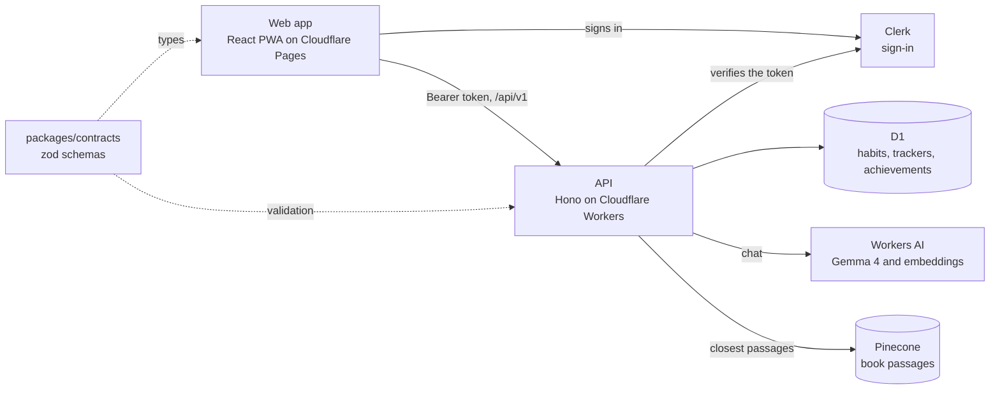

# Track N' Stick

A habit tracker: a React web app and the API behind it, in one repository.
Pick the days a habit is due, tick it off each day, and watch streaks,
completion rates and achievements build up. A habit coach grounded in
_Atomic Habits_ answers questions along the way.

**Live app:** [tracknstick.com](https://tracknstick.com)


## What it does

- **Daily tracker**: today's habits as one-tap toggles, with a sound for each
  completion and another when the day's habits are all done. Step back and
  forward through the days to see or fix any date.
- **Habits overview**: every habit in one table, with All, Active and Archived
  tabs (a habit with an end date is archived) and search; edit or delete from
  each row.
- **Progress**: a chart of daily completion rates, a calendar of completed
  days, current and longest streaks of days where every habit was done, and
  achievements by category, each with its progress toward being earned.
- **Habit coach**: a chat that streams answers from Gemma 4 on Workers AI,
  grounded in passages from _Atomic Habits_ retrieved for each question.
- **Time zones**: every day, streak and completion is counted in the user's own
  time zone, through daylight saving changes.
- **Installable**: a progressive web app in light and dark themes, with the app
  shell cached so it opens offline.

## How it fits together



Every request and response is defined once, as a zod schema in
`packages/contracts`: the API validates requests with it, the web app takes its
types from it, and a contract test checks each endpoint's responses against it.

## Tech stack

| Area     | Built with                                                                          |
| -------- | ----------------------------------------------------------------------------------- |
| Web app  | React 19, Vite, React Router 7, SWR, Tailwind CSS 4, Radix UI, Recharts             |
| PWA      | vite-plugin-pwa (Workbox)                                                           |
| Auth     | Clerk                                                                               |
| API      | Hono on Cloudflare Workers, Cloudflare D1, Rate Limiting bindings                   |
| AI       | Workers AI through the Agents SDK's `createAI` and AI SDK 7, Pinecone               |
| Shared   | zod 4 schemas in `packages/contracts`                                               |
| Testing  | Vitest 4 (the API's tests run in workerd against a real D1), Playwright             |
| Delivery | Cloudflare Pages for the web app; GitHub Actions deploys the API and its migrations |

## Layout

| Path                                       | What it is                                                          | Deployed by                         |
| ------------------------------------------ | ------------------------------------------------------------------- | ----------------------------------- |
| [`apps/web`](apps/web)                     | React 19 + Vite progressive web app                                 | Cloudflare Pages, on push to `main` |
| [`apps/api`](apps/api)                     | Hono API on Cloudflare Workers, with a D1 database                  | GitHub Actions (`deploy-api.yml`)   |
| [`packages/contracts`](packages/contracts) | zod schemas for every API request and response, shared by both apps | Bundled into the API                |

Each app has its own README with setup details, architecture and environment
variables.

## Getting started

Requires Node 22 and pnpm (the version is pinned in `package.json`).

```bash
pnpm install
```

Dependencies for both apps install from the single lockfile at the root. Then
give each app its local environment file:

- `apps/web/.env.local`, starting from `apps/web/.env.example`
- the API's local secrets, described in the [API README](apps/api/README.md)

## Commands

Run these from the repository root.

| Command         | What it does                                                                                                      |
| --------------- | ----------------------------------------------------------------------------------------------------------------- |
| `pnpm dev:web`  | Starts the web app's dev server                                                                                   |
| `pnpm dev:api`  | Starts the API locally, against a local database                                                                  |
| `pnpm build`    | Builds both apps                                                                                                  |
| `pnpm lint`     | Lints both apps                                                                                                   |
| `pnpm test`     | Runs the contracts', web app's and API's test suites once                                                         |
| `pnpm test:e2e` | Runs the end-to-end tests, signed in as a Clerk test user; see [`apps/web/e2e/README.md`](apps/web/e2e/README.md) |

To run any other script from one app, use a filter:

```bash
pnpm --filter @tracknstick/web test:coverage
pnpm --filter @tracknstick/api db:query "SELECT COUNT(*) FROM habits"
```

The API develops against a local database built from the files in
`apps/api/migrations`. Create it once, and run this again after pulling new
migrations:

```bash
pnpm --filter @tracknstick/api db:migrate
```

How schema changes are written and reach production is described in
[apps/api/migrations/README.md](apps/api/migrations/README.md).

`pnpm dev:api` keeps the database local but still sends the chat feature's AI
calls to Cloudflare, so it needs `wrangler login`. To run with nothing remote,
use `pnpm --filter @tracknstick/api dev:local`; chat will not get answers in
that mode.

## Documentation

- [`apps/web/README.md`](apps/web/README.md) and [`apps/api/README.md`](apps/api/README.md): each app's setup and architecture
- [`apps/api/docs/api.md`](apps/api/docs/api.md): every API endpoint and the schema for its request and response
- [`apps/api/docs/ERD.md`](apps/api/docs/ERD.md): the database schema
- [`apps/api/docs/operations.md`](apps/api/docs/operations.md): deployment, secrets, health checks and local troubleshooting
- [`apps/api/migrations/README.md`](apps/api/migrations/README.md): writing a migration
- [`apps/web/docs/rag-architecture.md`](apps/web/docs/rag-architecture.md) and [`apps/web/docs/setup-guide.md`](apps/web/docs/setup-guide.md): how the habit coach chat works, and how its book index is built
- `CLAUDE.md` at the root and in each app: guidance for coding agents

## License

[MIT](LICENSE)
