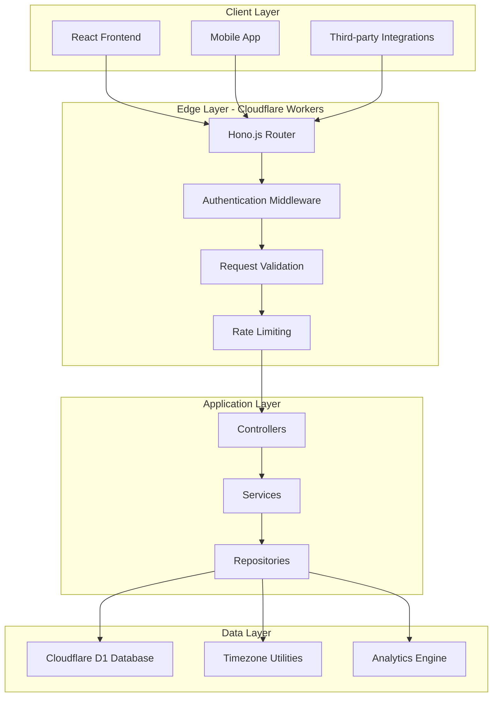

#  TrackNStick API

[](https://workers.cloudflare.com/)
[](https://www.typescriptlang.org/)
[](https://hono.dev/)
[](https://opensource.org/licenses/ISC)

> **A modern, scalable habit tracking API built for the edge** - powering personal growth through consistent habit formation and intelligent progress analytics.


## Overview

TrackNStick API is a high-performance, serverless REST API that provides the backbone for habit tracking applications. Built with modern web technologies and deployed on Cloudflare's global edge network, it handles habit analytics with precise timezone support.

** Live Frontend Application:** [Track N' Stick Web App](https://tracknstick.com/) *(React + TypeScript)*

### Key Differentiators

- ** Edge-First Architecture**: Deployed on Cloudflare Workers for global low-latency access
- ** Comprehensive Timezone Support**: Accurate habit tracking across all timezones with DST handling
- ** Advanced Analytics**: Real-time streak calculations, progress trends, and completion statistics
- ** Enterprise-Grade Security**: Clerk-powered authentication with JWT validation
- ** Mobile-Optimized**: RESTful design perfect for native mobile and progressive web apps

---

## ️ Technical Architecture



### Technology Stack

| Component | Technology | Purpose |
|-----------|------------|---------|
| **Runtime** | Cloudflare Workers | Serverless edge computing platform |
| **Framework** | Hono.js | Ultra-fast web framework optimized for edge |
| **Language** | TypeScript 5.8+ | Type-safe development with modern ES features |
| **Database** | Cloudflare D1 | Serverless SQLite |
| **Authentication** | Clerk | Modern auth platform with JWT tokens |
| **Validation** | Zod | Runtime type validation and schema parsing |
| **AI** | Workers AI + Pinecone | The habit coach chat, grounded in "Atomic Habits" |
| **Testing** | Vitest + Playwright | Unit and integration tests in workerd against a real D1; end-to-end tests with the web app |
| **Code Quality** | ESLint + Prettier | Automated linting and formatting |

---

##  Core Features

###  Habit Management
- **CRUD Operations**: Complete habit lifecycle management
- **Flexible Scheduling**: A habit is due on any chosen days of the week, between a start and an optional end date
- **Smart Defaults**: Intelligent habit creation with timezone-aware scheduling
- **Delete and Restore**: Deleted habits keep their history and can be restored

###  Advanced Analytics
- **Real-time Streak Calculation**: Current and longest streaks with timezone accuracy
- **Progress Insights**: Daily, weekly, and monthly completion rates
- **Trend Analysis**: Historical data analysis for pattern recognition
- **Achievement System**: Milestone tracking and progress celebrations
- **Habit Coach Chat**: Streamed answers grounded in "Atomic Habits", from passages retrieved for each question

###  Timezone Intelligence
- **Global Support**: Accurate tracking across all IANA timezones
- **DST Handling**: Automatic daylight saving time adjustments
- **Localized Calculations**: Streaks and progress calculated in user's local time
- **Migration Support**: Seamless timezone changes for traveling users

###  Security & Performance
- **JWT Authentication**: Stateless, secure authentication via Clerk
- **Request Validation**: Comprehensive input validation with Zod schemas
- **Rate Limiting**: Intelligent throttling to prevent abuse
- **Error Handling**: Graceful error responses with detailed logging

---

##  API Documentation

### Base URL
```
https://tracknstick-api.hi-00e.workers.dev/api/v1
```

### Authentication
Every `/api/v1` endpoint requires a Clerk session token in the Authorization header; `/health` does not:
```bash
Authorization: Bearer <your-jwt-token>
```

### Endpoints
[`docs/api.md`](docs/api.md) lists every endpoint (habits, trackers, progress, achievements, chat and health) with the zod schema in `packages/contracts` that defines its request and response.

```bash
# Habits due on a day, with that day's completion in the user's time zone
GET /habits?date=2025-01-15T00:00:00.000Z&timeZone=America/New_York

# Toggle a habit's completion for a day
POST /habits/:habitId/trackers
{
  "timestamp": "2025-01-15T08:00:00.000Z",
  "timeZone": "America/New_York"
}
```

Responses are the payload itself. Errors are `{ "error": { "message", "code" } }`, with `details` for validation failures outside production.

---

## ️ Development Setup

### Prerequisites
- **Node.js**: 20.12.2+ (LTS recommended)
- **pnpm**: 8.0.0+ (for efficient package management)
- **Wrangler CLI**: Latest version (Cloudflare development tool)

### Quick Start
```bash
# Clone the repository; the API lives in apps/api
git clone https://github.com/jayvicsanantonio/tracknstick.com.git
cd tracknstick.com

# Install dependencies for the whole workspace
pnpm install
cd apps/api

# Local secrets: wrangler dev reads them from .dev.vars (gitignored)
cp .dev.vars.example .dev.vars
# Edit .dev.vars with your Clerk development keys

# Setup local database
pnpm run db:setup

# Start development server
pnpm run dev
```

The API will be available at `http://localhost:3000`

### Development Scripts
```bash
# Development
pnpm run dev          # Local database; the AI binding still calls Cloudflare (needs wrangler login)
pnpm run dev:local    # Everything local, no login needed; chat cannot reach the AI model
pnpm run dev:remote   # Runs on Cloudflare against the production database

# Building & Deployment
pnpm run build        # Compile TypeScript
pnpm run deploy       # Deploy to Cloudflare Workers

# Database Operations
pnpm run db:migrate   # Apply pending migrations to the local database
pnpm run db:seed      # Seed the local database with sample data
pnpm run db:reset     # Delete the local database and rebuild it from the migrations
# Schema changes and how they reach production: see migrations/README.md

# Code Quality
pnpm run lint         # Run ESLint
pnpm run lint:fix     # Fix auto-fixable lint issues
pnpm run format       # Format code with Prettier

# Testing
pnpm run test         # Run test suite
pnpm run test:watch   # Run tests in watch mode
pnpm run test:coverage # Generate coverage report
```

---

##  Project Structure

```
src/
├── controllers/   # HTTP handlers: habits, progress, achievements, chat
├── routes/        # Route definitions, auth and request validation
├── services/      # Business logic
├── repositories/  # D1 queries: habits, trackers, achievements
├── middlewares/   # Clerk auth, rate limits, security headers, validation, errors
├── config/        # Environment-aware security settings
├── utils/         # Dates and time zones, streaks, errors, logging
├── types/         # Bindings and shared types
├── tests/         # Test setup, contract and integration tests
└── index.ts       # The Worker: middleware and routes
```

Request and response schemas live in `packages/contracts`; the database schema is built from `migrations/` ([ERD](docs/ERD.md)).

---

##  Testing Strategy

The project employs a comprehensive testing approach:

- **Unit Tests**: Individual function and method testing
- **Integration Tests**: API endpoint testing with real database interactions
- **Type Safety**: Comprehensive TypeScript coverage
- **Validation Testing**: Schema validation and edge case handling

```bash
# Run all tests
pnpm run test

# Generate coverage report
pnpm run test:coverage

# Watch mode for development
pnpm run test:watch
```

---

##  Timezone Handling

One of TrackNStick's key differentiators is its sophisticated timezone handling:

### Features
- **IANA Timezone Support**: Full support for all standard timezones
- **Automatic DST**: Daylight Saving Time transitions handled automatically
- **Accurate Calculations**: Streaks and progress calculated in user's local timezone
- **Migration Support**: Users can change timezones without losing data integrity

### Implementation
```typescript
// Example: Progress calculation with timezone support
GET /progress/history?timeZone=America/Los_Angeles

// Returns progress data adjusted for Pacific Time
{
  "history": [
    {
      "date": "2025-01-15",
      "completionRate": 100
    }
  ]
}
```

---

##  Security Implementation

### Authentication Flow
1. Frontend authenticates with Clerk
2. Clerk issues JWT token to client
3. Client includes token in API requests
4. API validates JWT signature and extracts user context
5. Request processed with user-scoped data access

### Security Features
- **JWT Validation**: Stateless token verification
- **Request Validation**: Input sanitization and validation
- **Rate Limiting**: Protection against abuse
- **CORS Configuration**: Controlled cross-origin access
- **Error Sanitization**: No sensitive data in error responses

---

##  Roadmap & Future Enhancements

### Phase 1: Core Enhancements
- [ ] Habit templates and categories
- [ ] Advanced streak rules (skip days, grace periods)
- [ ] Habit dependencies and chains

### Phase 2: Analytics & Insights
- [ ] Predictive analytics for habit formation
- [ ] Personalized insights and recommendations
- [ ] Export functionality (CSV, JSON)

### Phase 3: Social Features
- [ ] Habit sharing and community challenges
- [ ] Friend connections and accountability partners
- [ ] Points and levels on top of achievements

### Phase 4: Integration & Automation
- [ ] Calendar integration (Google, Outlook)
- [ ] Webhook support for third-party integrations
- [ ] Mobile app companion API enhancements

---

##  Contributing

We welcome contributions! Please see our contributing guidelines:

1. **Fork** the repository
2. **Create** a feature branch (`git checkout -b feature/amazing-feature`)
3. **Follow** our coding standards (ESLint + Prettier)
4. **Add** comprehensive tests
5. **Commit** with a short imperative subject ("Fix streak rollover")
6. **Push** to your branch
7. **Open** a Pull Request

### Development Standards
- **TypeScript**: Strict mode enabled, full type coverage
- **Testing**: All new features require tests
- **Documentation**: API changes must include documentation updates
- **Performance**: Edge-optimized code, minimal dependencies

---

##  Support & Contact

- **GitHub Issues**: [Report bugs or request features](https://github.com/jayvicsanantonio/tracknstick.com/issues)
- **Documentation**: [`docs/`](docs/): the API reference, the database schema, operations and the product brief
- **Developer**: Jayvic San Antonio
- **Web App**: [`apps/web`](../web), in this repository

---

##  License

This project is licensed under the ISC License - see the [LICENSE](LICENSE) file for details.

---

<div align="center">

**Built with ️ for developers who value quality, performance, and user experience**

[ Star this repo](https://github.com/jayvicsanantonio/tracknstick.com) | [ Report Bug](https://github.com/jayvicsanantonio/tracknstick.com/issues) | [ Request Feature](https://github.com/jayvicsanantonio/tracknstick.com/issues)

</div>
