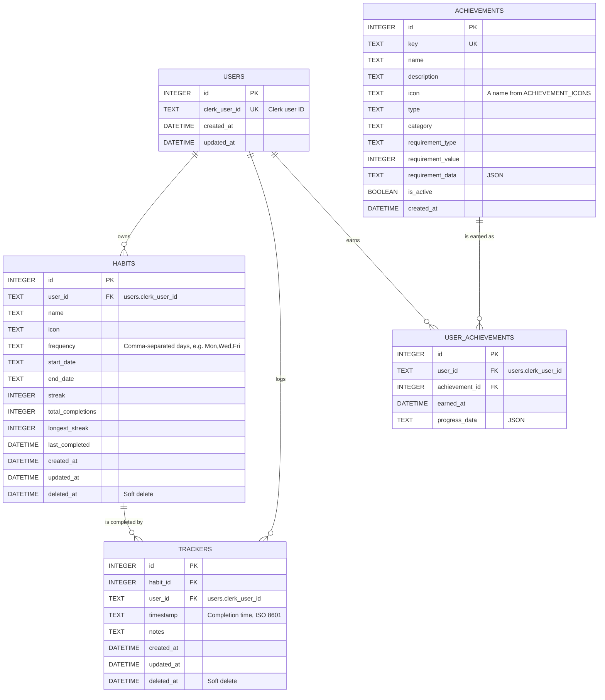

# Entity Relationship Diagram (ERD)

The database schema for the TrackNStick API: Cloudflare D1 (SQLite), built from
the numbered files in [`migrations/`](../migrations/README.md). Those files are
the source of truth; this page explains them.

## Diagram

## Tables

### users

One row per Clerk user, created the first time that user calls the API.
`clerk_user_id` is unique, and every other table refers to a user by it rather
than by the integer `id`.

### habits

A habit a user tracks. `frequency` is a comma-separated list of day
abbreviations (`Mon`, `Tue`, ... `Sun`); the repositories and services depend
on exactly these names. `start_date` and `end_date` bound the days the habit is
due. `streak`, `longest_streak`, `total_completions` and `last_completed` are
kept up to date as trackers are added and removed. Deleting a habit sets
`deleted_at`; restoring it clears it.

### trackers

One completion of a habit. A habit has at most one tracker per `timestamp`
(`UNIQUE(habit_id, timestamp)`). Completing a habit that already has a tracker
on that day, in the user's time zone, removes the tracker instead, so the same
endpoint marks a habit done and undone. Rows are soft deleted through
`deleted_at`.

### achievements

The achievement catalogue: one row per achievement, identified by its unique
`key`. Migration `0003_seed_achievements.sql` seeds and updates it, keyed by
`key`, so an achievement keeps its `id` when the seed runs again. `icon` is one
of the lucide icon names in `ACHIEVEMENT_ICONS` (`packages/contracts`). The
requirement columns say what earning it takes, for example a streak of 7 days.

### user_achievements

The achievements each user has earned, at most once each
(`UNIQUE(user_id, achievement_id)`), with when and any progress data.

## Integrity

- Every foreign key cascades on delete: deleting a user removes their habits,
  trackers and earned achievements, and deleting a habit row removes its
  trackers. The app itself soft deletes habits and trackers, so these cascades
  only apply to hard deletes.
- Indexes cover the lookups the repositories make: by user on habits, trackers
  and user_achievements; by habit and timestamp on trackers; `deleted_at` on
  habits and trackers; and key, type and category on achievements.
